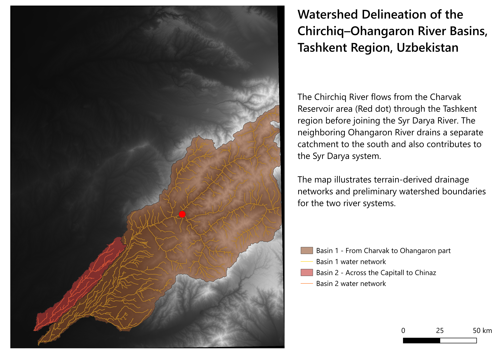

# Chirchiq–Ohangaron Watershed Delineation

GIS-based watershed delineation in the Tashkent region of Uzbekistan using **QGIS** and **GRASS GIS**.

## Watershed Map

## Methodology

- DEM preparation and terrain analysis
- Flow direction and accumulation using GRASS GIS
- Drainage network extraction
- Outlet selection and watershed delineation

## Limitations

The analysis identified two separate contributing areas within the Chirchiq–Ohangaron river region. The delineated boundaries are preliminary and have not been independently validated against official watershed datasets.

Potential uncertainties include DEM resolution, flow routing, and outlet placement, particularly near the Syr Darya confluences.

## Tools

QGIS · GRASS GIS · DEM
